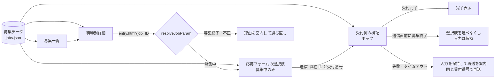

# tetote-application-example

採用サイトの募集情報を起点に、希望職種を固定 ID で応募フォームへ引き継ぐ流れを示す公開用サンプルです。

自主制作サイト（架空企業の採用サイト「TETOTE」）で実装した機能から、公開用に切り出し・調整したサンプルです。サイト全体のソースコード、WordPress テーマ、共通の開発基盤は含みません。判定や送信の処理は元の実装からの抽出、画面とモックの送信先は公開用に作り直した最小構成です（詳しくは「[元の実装との関係](#元の実装との関係)」）。ディレクトリ構成も元サイトとは異なります（「[元サイトとの構成の違い](#元サイトとの構成の違い)」）。

- 元の公開サイト（架空の企業「TETOTE」の採用サイト）: https://recruit-tetote.preview-dev.website/

> 同梱の募集データは架空のものです。実在の求人ではありません。送信先はブラウザー内のモックで、入力内容はどこにも送信・保存されません。

## 担当範囲

元サイトのデザインは他者によるもので、私はデザイン制作を担当していません。担当したのはコーディングと実装で、このサンプルに含まれる範囲は次のとおりです。

- 募集情報を 1 か所で管理し、募集一覧・職種別詳細・応募フォームの選択肢・送信先の検証に使う構成
- 「この職種に応募」から職種 ID を引き継ぎ、不正な ID・募集終了の職種を案内する処理
- 送信中の表示・押し直しの抑止・待ち時間の上限・失敗時の入力保持・再送の二重受付防止
- 上記のテスト

このサンプルの画面スタイルは公開用に用意した簡素なもので、元サイトのデザインではありません。

## このサンプルで見てほしいこと

更新担当者が募集を「終了」にしたとき、一覧・詳細・応募フォーム・受付側の判断が食い違わないことを中心に設計しています。

- **募集情報の正は 1 か所。** 一覧・詳細・応募フォームの選択肢は、同じ募集データ（元サイトでは WordPress のカスタム投稿、このサンプルでは `public/data/jobs.json`）から作ります。応募フォーム用に職種のリストを別に持ちません。持つと、募集終了の反映漏れで画面どうしが食い違うためです。
- **職種は表示名ではなく固定 ID で受け渡す。** 「この職種に応募」のリンクは `entry.html?job=sales` の形で、送信値も ID です。職種名を少し直しただけで受付側が拒否する、という事態を防ぎます。URL には氏名などの個人情報を載せません。
- **URL の値は信用しない。** `?job=` は誰でも書き換えられるため、画面に出ている募集中の選択肢と照合します。不正な値は画面に出さず、募集終了の職種はデータ側の職種名で理由を案内し、「希望職種を選び直す」から選択肢へフォーカスを移せます。
- **送信先でも受付状態を確かめる。** ページを開いた後に募集が終わることがあるため、受付側は職種 ID と送信時点の受付状態を検証し直します。募集終了が返ったら、その選択肢を選べなくして理由を項目の近くに出し、他の入力は残したまま別の職種を選び直してもらいます。
- **タイムアウトを「未送信」と決めつけない。** 待ち時間の上限で打ち切っても、受付側では受付が済んでいるかもしれません。再送は同じ受付番号で送り、受付側が二重に受け付けないようにしています。内容を直した場合は別の応募として新しい番号を使います。
- **成功応答を確認してから完了へ進む。** HTTP 200 だけでは成功とみなさず、応答の内容が「受付完了」のときだけ完了を表示します。
- **入力内容はメモリにだけ持つ。** 入力内容を localStorage などに保存しません。完了後は画面の入力欄も空にします。

### アクセシビリティ

- エラーは項目の近くに出し、`aria-invalid` と `aria-describedby` で項目と結びます。送信時は DOM 上で最初のエラー項目へフォーカスします。
- 送信中は、ボタンの文言（「送信中…」）・`aria-busy`・`role="status"` の 3 つで伝えます。ボタンは `disabled` にせず `aria-disabled` にします（`disabled` にするとフォーカスが外れ、文言の変化も読み上げられないため）。押し直しはスクリプト側で止めます。
- 希望職種はネイティブのラジオボタンを `fieldset` / `legend` でまとめています。募集終了は色だけでなく「募集終了」の文字でも示します。
- 完了したら完了の見出しへフォーカスを移します。

## 起動・テスト・ビルド

```bash
npm ci          # 依存のインストール（package-lock.json どおり）
npm run dev     # 開発サーバー（http://localhost:5173/）
npm test        # テスト（Vitest）
npm run build   # 型チェック＋ビルド（dist/ に出力）
npm run preview # ビルド結果の確認（http://localhost:4173/）
```

募集データは `fetch` で読み込むため、HTML をファイルとして直接開くと動きません。開発サーバーかプレビューで確認してください。

### 画面での確認方法

1. 募集一覧（`index.html`）で「この職種に応募」を押すと、その職種を選択済みの応募フォームが開きます。
2. 応募フォームの下にある「確認用：モックの送信先」で、次の送信への応答を切り替えられます（元サイトには無い、確認用の部品です）。
   - 受け付ける … 入力に不備があればエラーを返します
   - 受け付ける直前に、選んだ職種を募集終了にする … 応募直前の募集終了
   - 送信先のエラー（HTTP 500）
   - 受け付けたが応答が返らない（タイムアウト）… 受付後に応答を返しません。このページでは待ち時間の上限を 8 秒にしています（元の実装は 20 秒）。続けて「受け付ける」に戻して再送すると、受け付けた件数が増えないことを確認できます
3. `entry.html?job=engineer`（募集終了）や `entry.html?job=unknown`（存在しない ID）を直接開くと、案内が表示されます。

## 使用技術・実行環境

| 用途 | 使用しているもの |
| --- | --- |
| 言語 | TypeScript 5.9 |
| 開発サーバー・ビルド | Vite 7（一覧・詳細・応募フォームの 3 ページ） |
| スタイル | Sass（SCSS）、FLOCSS の命名・層構成（各ファイルから `@use 'global' as *;` で共通の値を読む） |
| テスト | Vitest 4、jsdom 27（画面テスト） |
| 実行環境 | Node.js 22.23.4 以上（22 系）・24.22.1 以上（24 系）・26.12.1 以上、npm |

フレームワーク・CMS・データベース・外部 API は使っていません。

## 構成

```
.
├── index.html               # 募集一覧
├── job.html                 # 職種別詳細（?id=<職種 ID>）
├── entry.html               # 応募フォーム（?job=<職種 ID>）と確認用のモック操作
├── public/data/jobs.json    # 架空の募集データ（WordPress の募集職種を想定した形）
├── src/
│   ├── main.ts              # エントリー（ページに応じて起動）
│   ├── entry/
│   │   ├── jobs.ts          # 募集データの検証・並べ替え・URL・?job= の判定・受付状態の確認
│   │   ├── validate.ts      # 入力項目の検証（ブラウザーとモックの送信先で共用）
│   │   ├── submit.ts        # 送信・応答の読み取り・待ち時間の上限・受付番号
│   │   └── form.ts          # 応募フォームの画面制御
│   ├── pages/jobs-view.ts   # 募集一覧・職種別詳細の描画
│   ├── mock/server.ts       # モックの送信先（ブラウザー内だけで動く）
│   └── styles/              # SCSS（FLOCSS）
│       ├── main.scss        # 層の順に読み込むエントリー
│       ├── global/          # 色・基準値・関数・メディアクエリ・フォーカスの mixin（CSS を出力しない）
│       ├── foundation/      # 要素の土台
│       ├── layout/          # l-container
│       ├── component/       # c-button / c-form-field / c-choice / c-required
│       ├── project/         # p-intro / p-jobs / p-job / p-entry / p-mock
│       └── utility/         # u-visually-hidden
└── tests/
    ├── jobs.test.ts         # 募集データ・URL・?job= の判定
    ├── submit.test.ts       # 送信結果の分類・タイムアウト
    ├── mock-server.test.ts  # 受付側の検証の再現（職種・受付状態・二重受付）
    ├── entry-form.test.ts   # 応募フォームの操作（jsdom）
    └── jobs-view.test.ts    # 一覧・詳細の表示（jsdom）
```

読み始めるなら `src/entry/jobs.ts` → `src/entry/form.ts` → `src/mock/server.ts` の順がおすすめです。

### スタイルの構成

元サイトと同じく、スタイルは FLOCSS の層（foundation → layout → component → project → utility）に分け、層ごとの `_index.scss` に読み込み順を書いています。色・基準値・関数・mixin は `global/` にまとめ、各ファイルから `@use 'global' as *;` で読み込みます（`vite.config.ts` の `loadPaths` で解決）。JavaScript が要素を探すときは `js-` で始まるクラスを使い、`l-` `c-` `p-` `u-` のクラスには触れません。状態は `aria-invalid`・`aria-disabled`・`hidden` などで表し、見た目の切り替えは CSS 側に置いています。

## 元サイトとの構成の違い

このリポジトリのディレクトリ構成とファイルの分け方は、公開用サンプルに合わせて用意したものです。**元サイトの構成とは異なります。**

| | 元サイト | このサンプル |
| --- | --- | --- |
| 作り方 | Astro で静的に実装し、WordPress のテーマへ移植 | Vite と TypeScript だけで動く 3 つの HTML |
| 募集情報の管理 | WordPress のカスタム投稿「募集職種」とカスタムフィールド（管理画面で更新） | `public/data/jobs.json`（架空データ） |
| 一覧・詳細の出力 | WordPress のテンプレート（PHP）がサーバー側で出力 | ブラウザーで JSON を読み込んで描画 |
| 応募フォームの送信先 | WordPress 版は Contact Form 7、静的版は Google Apps Script | ブラウザー内のモック |
| JavaScript | 機能ごとのモジュール（JavaScript）と共通のフォーム基盤 | このサンプル用の TypeScript のモジュール |
| スタイル | FLOCSS の層構成。共通の値・mixin・フォント・デザインの値を `global/` に持つ | 同じ層構成と `@use 'global' as *;` の読み込み方。`global/` の中身は、このサンプル用に書き下ろした最小限のもの |

クラス名（`c-button` など）・変数名・ブレークポイントも、元サイトとは一致しません。元サイトのデザイン（配色・レイアウト・画像）は再現していません。

## データの流れ



## ブラウザー側の検証と受付側の検証

| | このサンプル | 元の実装（実環境） |
| --- | --- | --- |
| ブラウザー側 | `validate.ts` で必須・形式・文字数を検証し、エラーを項目の近くに表示 | 共通のフォーム検証で同様に表示 |
| 受付側 | モック（`mock/server.ts`）が `validate.ts` と職種の受付状態の確認（`checkJob`）で検証し直す | WordPress 版はテーマの PHP、静的版は Google Apps Script が検証し直す |

ブラウザー側の検証は、送る前に気づいてもらうためのもので、改ざんや直接の送信は止められません。このサンプルの受付側はブラウザー内のモックなので、**モックで成功しても、実際の送信や不正送信対策を検証したことにはなりません。**

元の実装には静的版（Google Apps Script へ送信し、確認画面あり）と WordPress 版（Contact Form 7 の REST API へ送信）があります。このサンプルは WordPress 版の応答の形（`status` / `invalid_fields`）に合わせ、確認画面のない流れにしています。Contact Form 7 による受け付け・メール送信と、Cloudflare Turnstile による確認は既製のプラグイン・サービスの機能で、このサンプルには含まず、自作の実装でもありません。

## 元の実装との関係

| ファイル | 扱い | 内容 |
| --- | --- | --- |
| `src/entry/jobs.ts` | 抽出・変更 | `resolveJobParam`（?job= の判定）は元の実装を TypeScript にしたもので、判定は同じです。募集中を先頭に並べる処理と ID の形式による除外は、元のサーバー側の処理を参考に書き直しました。`checkJob` は元の受付側の職種の判定（存在しない ID と募集終了を分ける）を TypeScript で再実装したものです。同じ ID の重複を除外する処理は公開用に追加しました |
| `src/entry/submit.ts` | 抽出・変更 | `postEntry`（待ち時間の上限・成功応答の確認）と `normalizeCf7Response` は元の実装から Contact Form 7 形式の部分を抜き出し、TypeScript にしました。文言は元の実装と同じです |
| `src/entry/validate.ts` | 再実装 | 元の受付側の検証から、公開用の 4 項目（お名前・メールアドレス・希望職種・自己PR）の部分を書き直しました。文字数の上限と形式は元と同じです |
| `src/entry/form.ts` | 再実装 | 元の画面制御（職種の引き継ぎ・送信中の表示・募集終了の扱い・受付番号）は共通のフォーム基盤に依存しているため、同じ振る舞いをこのサンプル用に書き直しました |
| `src/pages/jobs-view.ts` | 再実装 | 元の一覧・詳細テンプレートの方針（募集終了は後ろへ回して明示し、応募ボタンを出さない。詳細は 404 にしない）に合わせて書き直しました |
| `src/mock/server.ts` | 新規 | 公開用のモックの送信先です |
| `index.html` / `job.html` / `entry.html` / `src/styles/` | 新規 | 公開用の簡素なマークアップとスタイルです。スタイルの層構成は元サイトにならっていますが、中身は書き下ろしで、元サイトのデザインや共通の SCSS は含みません |
| `tests/jobs.test.ts` / `tests/submit.test.ts` | 抽出・変更 | 元のテストのうち、?job= の判定と送信結果の分類の部分を TypeScript にし、このサンプルの処理に合わせたテストを足しました |
| `tests/mock-server.test.ts` / `tests/entry-form.test.ts` / `tests/jobs-view.test.ts` | 新規 | このサンプルで追加したテストです |
| `public/data/jobs.json` | 新規 | 架空の募集データです。職種 ID の付け方は元と同じ考え方（投稿のスラッグ）です |

元サイトとの主な違いは次のとおりです。

- **完了画面:** 元サイトは完了ページへ移動します。このサンプルは同じページ内で完了を表示し、入力欄を空にします。
- **入力項目:** 元サイトはフリガナ・電話番号・生年月日・知ったきっかけ・同意などを含みます。このサンプルは職種の連携に必要な 4 項目に絞りました。
- **エラーの見た目:** 元サイトは共通の吹き出し形式でエラーを表示します。このサンプルは項目の下に文で表示します。

## 確認済みの内容と未確認の事項

確認済み（2026 年 11 月 4 日）:

- `npm ci` → `npm test` → `npm run build` が、`node_modules` のない状態から成功すること（Linux、Node.js 22.23.4・npm 10.9、テスト 49 件）
- テストの内訳: 募集データ・URL・判定 16 件、送信結果の分類 8 件、モックの受付側 8 件、応募フォームの操作 13 件、一覧・詳細 4 件
- Chromium（Playwright、ビルド結果をプレビューで表示）で、PC 幅（1280px）とスマートフォン幅（iPhone 13 相当）の次の操作
  - 募集一覧 → 職種別詳細 →「この職種に応募」→ 職種が選択済みのフォーム → 送信 → 完了
  - 未入力で送信したときのエラー表示と、最初のエラー項目へのフォーカス
  - 送信直前の募集終了・送信先のエラーで入力内容が残ること
  - 募集終了の ID・存在しない ID を指定したときの案内
  - 3 ページとも横スクロールが出ないこと
- PC 幅で、タイムアウト（8 秒）後に入力内容が残り、再送しても受け付けた件数が 1 件のままであること
- キーボード（Tab・矢印キー・Enter）だけで、一覧から応募フォームを開き、入力・職種の変更・送信までできること（PC 幅）

未確認:

- Safari・Firefox・実機のスマートフォンでの表示と操作
- macOS・Windows での `npm ci`・テスト・ビルド（Linux でのみ確認しています）
- スクリーンリーダーでの読み上げ（属性の設定はテストで確認していますが、実際の読み上げは確認していません）
- 実際の送信先（Contact Form 7・Google Apps Script）への送信、メール送信、迷惑送信対策。このサンプルでは行っていません

## 公開していない部分

元サイトのうち、次の部分はこのサンプルに含めていません。

- WordPress テーマ一式（カスタム投稿・カスタムフィールドの定義、テンプレート、管理画面の説明文）
- 受付側の処理（WordPress の PHP、Google Apps Script）と、メール送信・迷惑送信対策（ハニーポット・送信までの時間・回数制限・Turnstile の設定）
- 共通のフォーム基盤（エラーの吹き出し・確認画面など）、静的実装から WordPress への資材の同期、ビルド・納品の仕組み
- 実際の送信先・フォームの設定・メールの設定

## 著作権・ライセンス

- Copyright (c) 2026 tzk-s. All rights reserved.
- このリポジトリはポートフォリオとして公開しているもので、オープンソースライセンスは付与していません。コードの再利用・再配布・他の制作物への組み込みは許諾していません（著作権は作者に留保します）。
- 内容を評価するために、clone してローカルで実行・テストすることは問題ありません。
- なお、GitHub の利用規約により、公開リポジトリは GitHub 上で閲覧・fork できます。
- 依存ライブラリはそれぞれのライセンスに従います（`package-lock.json` 参照）。リポジトリにはライブラリ本体を含めていません。
- 画像・フォント・元サイトのデザイン素材は含めていません。
